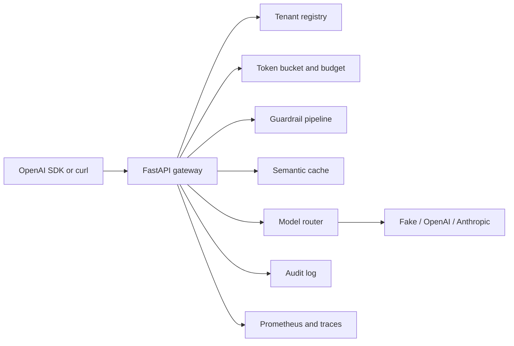
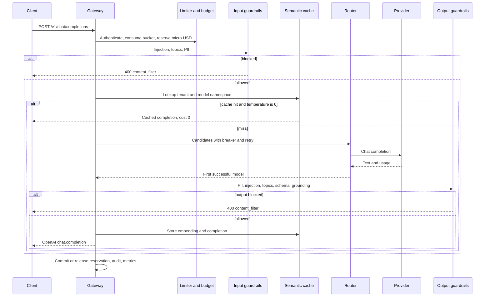

# Architecture

llm-guard-platform is an OpenAI-compatible gateway. Callers keep the chat-completions contract. The process in front of the model authenticates the tenant, reserves budget, runs guardrails, routes to a provider, and writes an audit record that does not contain the prompt.

## Components

Policy packs live in `configs/policies/*.yaml` and are bound to tenants in `configs/gateway.yaml`. Routes name an ordered list of models. A direct model id is also accepted and keeps the rest of its route as fallbacks.

## Request lifecycle

Buffered streaming runs this sequence to completion, then emits SSE. Incremental streaming can only fail closed between chunks, so the default for regulated tenants is buffered.

## What is recorded

Each guardrail stage appends a `GuardTrace`: stage, direction, decision, reason codes, optional score, and latency. The audit log stores a hash of the prompt. Raw prompts are not written. Prometheus counters and histograms use a registry owned by the process. OpenTelemetry spans (`gateway.request`, `guardrails.input`, `guardrails.output`, `provider.call`, `cache.lookup`) are created on the global tracer. Export is left to the operator: add a span processor before startup. No OTLP exporter is bundled.

## Failure behavior

| Condition | HTTP | Notes |
| --- | --- | --- |
| Missing or unknown API key | 401 | Every configured digest is compared |
| Token bucket empty | 429 | `retry-after` is the deficit divided by the refill rate |
| Reservation would exceed the daily cap | 402 | In-flight reservations count |
| Guardrail block | 400 | `error.code=guardrail_blocked`, stage and reasons |
| Unknown model or route | 404 | |
| Every candidate failed or was open | 503 | Retries are inside one candidate |
| Body over `max_body_chars` | 413 | |

Prices are USD per million tokens. Reservations use the most expensive model on the route so a fallback cannot exceed the hold. Cache hits commit zero. Failures release the hold.
